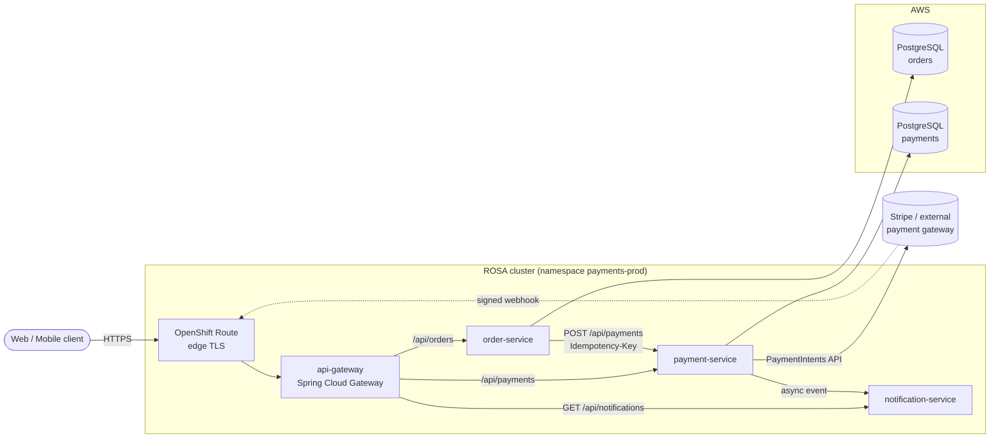
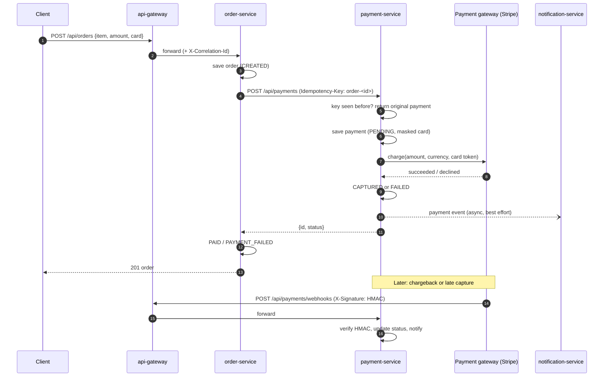
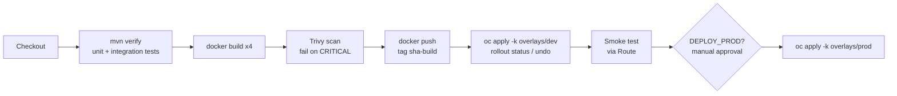

# Payment Gateway Integration on OpenShift ROSA: Project Report

**Repository:** `andrewsselvaraj/payment-gateway-microservices`
**Date:** 13 October 2026
**Stack:** Java 21, Spring Boot 3.3, Spring Cloud Gateway 2023.0, Maven, Docker, Jenkins, Kubernetes, Red Hat OpenShift Service on AWS (ROSA)

---

## 1. Summary

This project delivers a payment gateway integration platform as four Spring Boot microservices. A customer
order enters through an API gateway, the order service asks the payment service to charge the card, the
payment service talks to an external payment gateway (Stripe, or a built-in mock for development) and the
notification service tells the customer the outcome.

The system is containerised with a single multi-stage Dockerfile based on Red Hat's UBI OpenJDK runtime,
built and promoted by a Jenkins pipeline, and deployed to ROSA with Kustomize overlays for `dev` and `prod`.

Key properties:

- **No double charges.** Every charge carries an idempotency key (the order id); a retried request returns the original payment.
- **No card data at rest.** Only a masked PAN (`************4242`) is stored; request objects never print card data in logs.
- **Pluggable gateways.** New providers (Razorpay, Adyen, PayPal) implement one interface, `PaymentGatewayProvider`.
- **Verified webhooks.** Asynchronous gateway callbacks (chargebacks, late captures) must carry a valid HMAC-SHA256 signature.
- **Zero-downtime operations on OpenShift.** Rolling updates, liveness/readiness/startup probes, PodDisruptionBudgets, HPAs, zone spreading and default-deny NetworkPolicies.

## 2. Architecture



### 2.1 Services

| Service | Port | Data | Key endpoints |
|---|---|---|---|
| api-gateway | 8080 | none | Routes `/api/orders/**`, `/api/payments/**`, `GET /api/notifications/**`; adds `X-Correlation-Id` |
| order-service | 8081 | `orders` DB | `POST /api/orders`, `GET /api/orders/{id}`, `GET /api/orders` |
| payment-service | 8082 | `payments` DB | `POST /api/payments` (header `Idempotency-Key`), `GET /api/payments/{id}`, `GET /api/payments?orderId=`, `POST /api/payments/{id}/refund`, `POST /api/payments/webhooks` (header `X-Signature`) |
| notification-service | 8083 | in-memory (recent 200) | `POST /api/notifications`, `GET /api/notifications` |

All services expose `/actuator/health/liveness`, `/actuator/health/readiness` and `/actuator/prometheus`.

### 2.2 Service discovery and configuration

On OpenShift, services find each other through Kubernetes Service DNS (`http://payment-service:8082`), so no
Eureka server is needed. Non-secret configuration lives in the `payment-gateway-config` ConfigMap; credentials
(database, webhook secret, Stripe key) live in Secrets and are injected as environment variables. Each
environment differs only by its Kustomize overlay.

### 2.3 Database per service

`order-service` and `payment-service` each own their schema (database-per-service pattern). Locally and in
dev they use in-memory H2; in prod they use Amazon RDS for PostgreSQL, reached from the ROSA VPC.

## 3. Payment flow



### 3.1 Payment state machine

```
PENDING --charge ok--> CAPTURED --refund--> REFUNDED
   |                      |
   +--charge failed--> FAILED <--webhook (chargeback)--+
```

Refunds are only allowed from `CAPTURED`; a second refund returns HTTP 409.

### 3.2 Failure handling

| Failure | Behaviour |
|---|---|
| Card declined / insufficient funds | Payment `FAILED` with reason; order `PAYMENT_FAILED` |
| payment-service unreachable or times out | Order saved as `PAYMENT_PENDING`; safe to retry because the order id is the idempotency key |
| Client retries the same charge | Same payment returned, gateway not called again |
| notification-service down | Logged and ignored; payment outcome unaffected |
| Webhook with bad/missing signature | HTTP 401, no state change |
| Concurrent updates to one payment | JPA optimistic locking (`@Version`) |

## 4. Payment gateway integration

`payment-service` talks to gateways through the `PaymentGatewayProvider` adapter interface:

```java
public interface PaymentGatewayProvider {
    String name();
    ChargeResult charge(ChargeRequest request);
    ChargeResult refund(String providerReference, BigDecimal amount, String currency);
}
```

| Provider | Selected by | Notes |
|---|---|---|
| `mock` | `PAYMENT_PROVIDER=mock` (default, dev) | Deterministic sandbox: cards ending `0002` decline, `9995` insufficient funds, anything else succeeds |
| `stripe` | `PAYMENT_PROVIDER=stripe` + `STRIPE_API_KEY` (prod) | Uses Stripe PaymentIntents (`confirm=true`) and Refunds APIs, forwarding the idempotency key as Stripe's `Idempotency-Key` |

`ProviderRegistry` fails fast at startup if the configured provider is not available, so a misconfigured pod
never becomes Ready. Each payment records which provider handled it, so refunds go to the same provider even
after the default changes.

## 5. Security and compliance

- **PCI DSS scope reduction:** the service stores only a masked PAN. In production the client should tokenise cards with Stripe.js/Elements and send a `pm_...` PaymentMethod id; `cardNumber` validation already accepts these tokens, keeping raw card data out of the cluster entirely.
- **No secrets in Git:** only `secrets.example.yaml` templates are committed. Production secrets are created with `oc create secret` or synced from AWS Secrets Manager using the External Secrets Operator.
- **Transport:** TLS terminates at the OpenShift router (edge Route, HTTP redirected to HTTPS). For in-cluster mTLS, add OpenShift Service Mesh.
- **Network isolation:** a default-deny NetworkPolicy, then explicit allows: router to gateway, gateway to services, order to payment, payment to notification, and the monitoring namespace for scraping. `notification-service` accepts writes only from inside the cluster; the gateway exposes only `GET`.
- **Container hardening:** UBI 9 base image, non-root UID (works with OpenShift's `restricted-v2` SCC and arbitrary UIDs), all Linux capabilities dropped, no privilege escalation, `RuntimeDefault` seccomp.
- **Webhook authenticity:** HMAC-SHA256 over the raw body, compared in constant time.
- **Input validation:** Bean Validation on every request (amount > 0 with 2 decimal places, ISO currency, card format, email). Errors return RFC 7807 problem details.
- **Least-privilege CI:** Jenkins deploys with a namespace-scoped `jenkins-deployer` service account bound to the `edit` role, one token per environment.

## 6. CI/CD with Jenkins



- Images are tagged `<short git sha>-<build number>`, and the tag is pinned in the overlay with `kustomize edit set image` so every deployment is traceable to a commit.
- Each rollout is watched with `oc rollout status`; on failure the pipeline runs `oc rollout undo` and fails the build.
- Prod requires `DEPLOY_PROD=true` and a human approval.

**Jenkins setup**

1. Run Jenkins either on OpenShift (`oc new-app jenkins-persistent` from the OpenShift catalog) or on an existing server.
2. Give the agent JDK 21, Maven 3.9, Docker, `oc` and `kustomize` (optionally `trivy`).
3. Create the credentials `registry-credentials`, `rosa-dev-token` and `rosa-prod-token` (see section 7, step 6).
4. Create a Multibranch Pipeline job pointing at this repository; it picks up the `Jenkinsfile`.
5. Add a GitHub webhook to `https://<jenkins>/github-webhook/` so every push builds.

## 7. Deploying to ROSA: runbook

### Prerequisites

AWS account with ROSA enabled, `rosa`, `aws`, `oc` CLIs, and a Red Hat account.

```bash
# 1. Create the cluster (HCP, multi-AZ for prod)
rosa login --token=<red-hat-offline-token>
rosa create account-roles --hosted-cp --mode auto --yes
rosa create cluster --cluster-name payments-rosa --hosted-cp --sts --mode auto \
     --region us-east-1 --multi-az --compute-machine-type m6i.xlarge --replicas 3
rosa describe cluster -c payments-rosa          # wait for state: ready

# 2. Create an admin and log in
rosa create admin -c payments-rosa
oc login https://api.<cluster-domain>:6443 --username cluster-admin --password <password>

# 3. Projects
oc new-project payments-dev
oc new-project payments-prod

# 4. Databases (prod): Amazon RDS for PostgreSQL in the ROSA VPC, with databases
#    orders and payments; security group allows 5432 from the worker node subnets.

# 5. Secrets (prod)
oc -n payments-prod create secret generic payment-db \
   --from-literal=url=jdbc:postgresql://<rds-endpoint>:5432/payments \
   --from-literal=username=payments --from-literal=password='<pw>'
oc -n payments-prod create secret generic order-db \
   --from-literal=url=jdbc:postgresql://<rds-endpoint>:5432/orders \
   --from-literal=username=orders --from-literal=password='<pw>'
oc -n payments-prod create secret generic payment-gateway-secrets \
   --from-literal=webhook-secret="$(openssl rand -hex 32)" \
   --from-literal=stripe-api-key='<sk_live_...>'

# 6. Jenkins deployer accounts
for ns in payments-dev payments-prod; do
  oc apply -n $ns -f k8s/jenkins-rbac.yaml
  oc create token jenkins-deployer -n $ns --duration=8760h   # store in Jenkins
done

# 7. Image pulls: if the registry is private, link a pull secret
oc -n payments-prod create secret docker-registry quay-pull \
   --docker-server=quay.io --docker-username=<robot> --docker-password=<token>
oc -n payments-prod secrets link default quay-pull --for=pull

# 8. Deploy (Jenkins does this; manual equivalent)
oc apply -k k8s/overlays/dev
oc -n payments-dev get pods,route
./scripts/smoke-test.sh "https://$(oc -n payments-dev get route api-gateway -o jsonpath='{.spec.host}')"
```

### What gets deployed (per environment)

| Object | dev | prod |
|---|---|---|
| Deployments | 4 x 1 replica | 4 x 3 replicas, spread across AZs |
| HPA (CPU 70%) | 1 to 2 | 3 to 10 |
| PodDisruptionBudget | minAvailable 0 | minAvailable 1 |
| Database | H2 in-memory | Amazon RDS PostgreSQL |
| Gateway provider | mock | stripe |
| Route | edge TLS on api-gateway | edge TLS on api-gateway |
| NetworkPolicies | 6 | 6 |

Both overlays were rendered with `kustomize build` (dev: 27 objects, prod: 24 objects; prod's three secrets are created out of band).

## 8. Observability

- **Metrics:** Micrometer Prometheus endpoint on every service, tagged with `application`. `payment-service` adds business counters `payments_processed_total{provider,status}` and `payments_refunded_total{provider}`. Enable OpenShift user-workload monitoring and add a `ServiceMonitor` to scrape them, then alert on the ratio of `FAILED` payments.
- **Logs:** structured application logs go to stdout and are collected by OpenShift Logging; forward to Amazon CloudWatch with the ClusterLogForwarder.
- **Tracing:** the gateway adds `X-Correlation-Id` to every request and response. Adding Micrometer Tracing with OpenTelemetry would give full distributed traces.

## 9. Testing

`mvn clean verify` result at the time of this report: **12 tests, 0 failures.**

| Module | Tests | Covers |
|---|---|---|
| payment-service | 6 | capture + card masking, declined card, idempotent replay, refund once then 409, validation 400, webhook signature 401 vs. valid update |
| order-service | 3 | paid, declined, payment service down leads to `PAYMENT_PENDING` |
| notification-service | 2 | accept and list, validation |
| api-gateway | 1 | all three routes registered |

The Docker images and OpenShift deployment were not exercised in the build environment used to write this
report (no Docker daemon or cluster available); the Jenkins pipeline's Docker, deploy and smoke-test stages
are the first place they run end to end.

## 10. Recommended next steps

1. Replace `ddl-auto: update` with Flyway migrations before the first production release.
2. Move service-to-service events (payment to notification) onto a broker (Amazon MSK or AMQ Streams) with an outbox table for guaranteed delivery.
3. Add Resilience4j circuit breakers and retries on the order to payment call.
4. Add OAuth2/OIDC at the gateway (Red Hat build of Keycloak or Amazon Cognito) and per-merchant API keys.
5. Wire Stripe's native `Stripe-Signature` webhook format alongside the generic HMAC verifier.
6. Adopt GitOps (OpenShift GitOps / Argo CD) for prod so Jenkins only builds and the cluster pulls desired state from Git.
